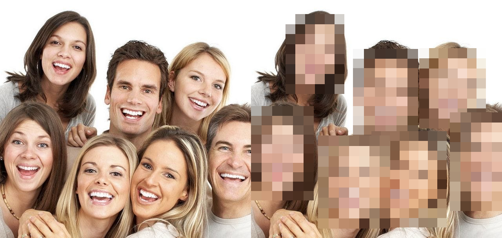
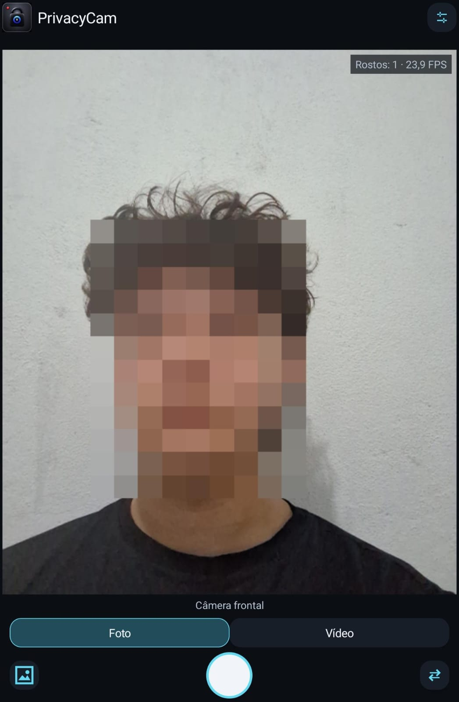

# PrivacyCam

**Real-Time Face Anonymization using Deep Learning, C++ and Android**

O **PrivacyCam** é um projeto de visão computacional desenvolvido para realizar detecção e anonimização facial em imagens, vídeos e transmissões de câmera em tempo real.

O sistema utiliza a rede neural convolucional **YuNet**, executada pelo OpenCV DNN, para identificar regiões faciais e aplicar pixelização sobre os rostos detectados.

A implementação possui um núcleo compartilhado em **C++17**, utilizado nas aplicações Desktop e Android por meio de **Kotlin, CameraX e JNI**.

O projeto também inclui um ambiente experimental de treinamento e fine-tuning com **Python, PyTorch e CUDA**, permitindo validar checkpoints e exportar modelos para ONNX.

A inferência é realizada localmente, sem dependência de servidores externos.

---

## Demonstração

### Detecção e anonimização facial

O PrivacyCam utiliza a CNN YuNet para localizar rostos e aplicar pixelização às regiões detectadas, incluindo uma margem adicional de proteção visual.

A comparação abaixo apresenta um teste com **sete rostos**, demonstrando o resultado da detecção e anonimização.

<p align="center">
  
</p>

<p align="center">
  <em>Comparação visual do processamento facial utilizando YuNet e pixelização.</em>
</p>

### Aplicação Android

A versão Android executa a CNN diretamente no dispositivo, utilizando inferência em CPU e o núcleo C++ para anonimização facial.

O aplicativo permite capturar fotografias e gravar vídeos com áudio, salvando os arquivos processados na galeria.

<p align="center">
  
</p>

<p align="center">
  <em>PrivacyCam em execução no Android, com detecção facial e pixelização em tempo real.</em>
</p>

---

## Funcionalidades

### Desktop

- Detecção facial utilizando YuNet.
- Anonimização por pixelização.
- Processamento de imagens e vídeos.
- Captura e processamento de transmissões em tempo real.
- Configuração do limiar de confiança e dos parâmetros de pixelização.
- Captura e processamento em threads separadas.
- Buffer limitado ao frame mais recente para reduzir o acúmulo de latência.

### Android

- Detecção e anonimização facial em tempo real.
- Inferência local utilizando C++17 e OpenCV.
- Suporte às câmeras frontal e traseira.
- Inicialização automática da câmera.
- Captura de fotografias anonimizadas.
- Gravação de vídeos MP4 com áudio sincronizado.
- Codificação H.264/AVC e AAC-LC.
- Armazenamento de mídias na galeria utilizando MediaStore.
- Configuração do limiar de confiança da CNN.
- Indicadores de FPS e quantidade de rostos detectados.
- Interface adaptável às orientações retrato e paisagem.
- Funcionamento offline.

### Deep Learning

- Preparação de dados de treinamento.
- Integração com a implementação de treinamento do YuNet.
- Experimentos de fine-tuning com PyTorch e CUDA.
- Validação de modelos e checkpoints.
- Exportação para ONNX.
- Verificação de compatibilidade com OpenCV.

---

## Tecnologias utilizadas

| Componente | Tecnologia |
|---|---|
| Linguagem principal | C++17 |
| Visão computacional | OpenCV |
| Detector facial | YuNet (CNN) |
| Inferência | OpenCV DNN |
| Formato dos modelos | ONNX |
| Treinamento e fine-tuning | Python e PyTorch |
| Aceleração de treinamento | CUDA |
| Desenvolvimento Android | Kotlin |
| Captura de câmera | CameraX |
| Integração nativa | JNI / Android NDK |
| Codificação de vídeo | MediaCodec / H.264 |
| Captura de áudio | AudioRecord |
| Codificação de áudio | AAC-LC |
| Multiplexação audiovisual | MediaMuxer |
| Armazenamento Android | MediaStore |
| Build Desktop | CMake |
| Build Android | Gradle / CMake |

---

## Arquitetura

O PrivacyCam utiliza uma arquitetura modular que separa aquisição de imagens, inferência neural, anonimização e apresentação dos resultados.

O núcleo C++ é compartilhado entre Desktop e Android, evitando a duplicação da lógica de detecção e pixelização.

### Pipeline de processamento

```text
Image / Video / Camera
          |
          v
    Frame Acquisition
          |
          v
     Preprocessing
          |
          v
    YuNet Inference
          |
          v
     Face Detection
          |
          v
    FaceAnonymizer
          |
          v
    Anonymized Frame
          |
          +------> Live Preview
          |
          +------> Image Storage
          |
          +------> Video Encoding
```

O fluxo consiste na aquisição do frame, preparação da imagem, inferência da CNN, identificação das regiões faciais, aplicação da pixelização e encaminhamento do resultado para visualização ou armazenamento.

O projeto realiza **detecção facial**, não reconhecimento facial. Não identifica pessoas nem armazena identidades biométricas.

---

## Núcleo de processamento C++

A implementação central utiliza C++17 e OpenCV, com componentes responsáveis por diferentes etapas do processamento.

### FaceDetector

Responsável pela execução do YuNet utilizando `cv::FaceDetectorYN`.

Inclui carregamento do modelo ONNX, configuração do limiar de confiança, definição das dimensões de entrada e retorno das regiões faciais detectadas.

### FaceAnonymizer

Aplica pixelização às regiões faciais identificadas. O algoritmo reduz a resolução dessas regiões e as amplia novamente, produzindo um efeito de mosaico.

Uma margem adicional é aplicada às caixas de detecção para aumentar a área visualmente ocultada.

### VideoProcessor

Realiza o processamento sequencial de arquivos de vídeo, preservando a ordem temporal dos frames.

### WebcamPipeline

Gerencia a captura e o processamento de transmissões de câmera em tempo real.

### LatestFrameBuffer

Mantém somente o frame mais recente disponível para processamento.

Essa estratégia evita filas crescentes quando a captura é mais rápida que a inferência, priorizando frames atuais e reduzindo a tendência de aumento da latência.

---

## Modelo de Deep Learning

### YuNet

O detector utilizado é o **YuNet**, uma rede neural convolucional desenvolvida para detecção facial eficiente.

Modelo original:

`models/face_detection_yunet_2023mar.onnx`

A inferência é executada em C++ por meio do OpenCV DNN, permitindo utilizar o mesmo modelo em Desktop e Android.

### Configuração de confiança

Na aplicação Android, o limiar padrão é:

```text
score_threshold = 0.6
```

Esse valor foi selecionado após testes físicos, nos quais apresentou melhor continuidade de detecção durante movimentos da cabeça em comparação com o limiar inicial de 0,9.

O parâmetro pode ser ajustado nas configurações do aplicativo. Limiares menores tornam a detecção mais permissiva, mas podem aumentar a ocorrência de falsos positivos.

### Treinamento e fine-tuning

O projeto inclui experimentos baseados na implementação de treinamento do YuNet com PyTorch.

Foi utilizada uma configuração experimental com subconjuntos do **WIDER FACE**:

| Parâmetro | Configuração |
|---|---|
| Imagens de treinamento | 1.000 |
| Imagens de validação | 200 |
| Épocas | 5 |
| Framework | PyTorch |
| Aceleração | CUDA |
| Exportação | ONNX |

Os modelos ajustados foram exportados para ONNX e submetidos a verificações de compatibilidade com a inferência C++.

Os experimentos não demonstraram melhoria consistente em relação ao modelo original. Por isso, **o YuNet original permanece como modelo padrão**, enquanto o fine-tuning é mantido como componente experimental.

---

## Aplicação Desktop

A versão Desktop utiliza C++17 e OpenCV para processamento de imagens, vídeos e transmissões ao vivo.

Em imagens estáticas, o detector identifica as regiões faciais e produz a saída pixelizada. Em vídeos armazenados, os frames são processados sequencialmente.

Para transmissões ao vivo, captura e inferência são executadas separadamente, com um buffer limitado ao frame mais recente.

Em ambientes WSL2 sem acesso direto à webcam, o projeto inclui uma ponte local para transmitir frames capturados no Windows para o processo Linux.

### Requisitos

- Linux.
- Compilador compatível com C++17.
- CMake.
- OpenCV com os módulos necessários.
- Modelo YuNet em ONNX.

O ambiente Desktop foi desenvolvido utilizando **OpenCV 4.10.0**.

### Compilação

Na raiz do repositório:

```bash
cmake -S . -B build -DCMAKE_BUILD_TYPE=Release
cmake --build build -j
```

### Exemplo de execução

Processamento de uma transmissão HTTP/MJPEG:

```bash
./build/privacycam \
    --stream http://HOST:8765/video \
    --model models/face_detection_yunet_2023mar.onnx \
    --confidence 0.7
```

Substitua `HOST` pelo endereço da máquina que disponibiliza a transmissão.

---

## Aplicação Android

A aplicação Android integra o núcleo C++ à interface Kotlin por meio da **Java Native Interface (JNI)**.

### CameraX e inferência nativa

O CameraX captura os frames e os encaminha ao código C++, responsável pela detecção YuNet e pela pixelização.

O pipeline utiliza `ImageAnalysis` com `STRATEGY_KEEP_ONLY_LATEST`, priorizando frames recentes.

A implementação também trata conversões de imagem, strides, rotação, espelhamento, reutilização de buffers e descarte de resultados obsoletos.

A interface apresenta somente os frames retornados pelo processamento nativo, sem utilizar a prévia bruta da câmera como visualização principal.

### Captura de fotografias

As fotografias são produzidas a partir de frames previamente anonimizados.

O armazenamento utiliza `MediaStore.Images`, no diretório:

`Pictures/PrivacyCam/`

A resolução inicial corresponde ao frame efetivo do pipeline de análise, solicitado em aproximadamente 640 × 480 pixels.

### Gravação de vídeos com áudio

O aplicativo utiliza `MediaCodec` para codificação de vídeo H.264/AVC.

O áudio é capturado pelo `AudioRecord` e codificado em AAC-LC. As trilhas são sincronizadas por timestamps e combinadas em arquivos MP4 pelo `MediaMuxer`.

Os vídeos são armazenados utilizando `MediaStore.Video`, no diretório:

`Movies/PrivacyCam/`

Somente frames processados pelo pipeline de anonimização são encaminhados ao encoder de vídeo. O áudio é gravado normalmente, sem anonimização de voz.

### Ambiente de desenvolvimento

| Ferramenta | Configuração |
|---|---|
| Java | JDK 17 |
| Android SDK | 36 |
| Android NDK | r28c |
| Android CMake | 3.22.1 |
| Gradle | 8.13 |
| OpenCV Android | 4.14.0 |
| ABI | arm64-v8a |
| minSdk | 26 |
| targetSdk | 36 |

A integração utiliza OpenCV Android por AAR/Prefab, com bibliotecas nativas verificadas quanto à compatibilidade com páginas de memória de 16 KB.

### Compilação Android

Na raiz do repositório:

```bash
cd android
./gradlew assembleDebug
```

APK gerado:

```text
android/app/build/outputs/apk/debug/app-debug.apk
```

Instalação em um dispositivo conectado por ADB, a partir de `android/`:

```bash
adb install -r app/build/outputs/apk/debug/app-debug.apk
```

Inicialização:

```bash
adb shell am start -n com.privacycam.android/.MainActivity
```

---

## Estrutura do repositório

```text
privacycam/
|
|-- android/
|   |-- app/
|   |-- gradle/
|   |-- gradlew
|
|-- cpp/
|
|-- models/
|   |-- face_detection_yunet_2023mar.onnx
|
|-- training/
|   |-- prepare_dataset.py
|   |-- prepare_upstream.py
|   |-- smoke_train.py
|   |-- validate.py
|   |-- finetune.py
|
|-- tools/
|   |-- windows_camera_bridge.py
|
|-- logo/
|
|-- docs/
|   |-- imagens/
|       |-- android/
|           |-- multiple_faces_comparison.png
|           |-- privacycam_android.jpeg
|
|-- CMakeLists.txt
|-- .gitignore
|-- README.md
```

Datasets, checkpoints experimentais, ambientes virtuais e artefatos de compilação são excluídos do versionamento padrão.

---

## Testes e validação

O PrivacyCam foi desenvolvido incrementalmente, com testes de inferência, processamento e integração entre plataformas.

### Desktop

Foram validados:

- Compilação C++ e carregamento do modelo ONNX.
- Detecção e pixelização em imagens, incluindo um teste com sete rostos.
- Processamento de vídeos e transmissões ao vivo.
- Funcionamento do buffer de frames recentes.
- Compatibilidade de modelos exportados.

### Android

A aplicação foi testada em um **Samsung Galaxy Tab S10 Lite**, com inferência local em CPU.

Foram validados:

- Integração JNI e inferência YuNet no Android.
- Anonimização em tempo real.
- Câmeras frontal e traseira.
- Rotação e espelhamento.
- Captura de fotos e salvamento na galeria.
- Gravação de vídeos MP4 com áudio sincronizado.
- Reprodução dos vídeos e configuração de confiança.

Em uma execução registrada no dispositivo, a aplicação apresentou aproximadamente **26,6 FPS**.

Esse valor representa uma observação pontual, não um benchmark formal. O desempenho depende do hardware, da resolução e das condições de execução.

---

## Privacidade e limitações

O PrivacyCam executa detecção e anonimização localmente, sem necessidade de servidores externos.

Entretanto, **a pixelização não garante anonimato absoluto**. O sistema depende das detecções realizadas pela CNN YuNet: rostos não identificados poderão permanecer visíveis.

A detecção pode apresentar limitações com rostos de perfil, oclusões, iluminação insuficiente, movimentos intensos e baixa resolução.

Além disso, roupas, objetos, cenários e vozes podem fornecer informações identificáveis. O áudio gravado não passa por anonimização.

Portanto, o PrivacyCam é uma implementação experimental de **ocultação visual de rostos**, não um sistema com garantia formal de proteção de identidade.

---

## Referências

- [OpenCV](https://opencv.org/)
- [OpenCV Zoo — YuNet](https://github.com/opencv/opencv_zoo/tree/main/models/face_detection_yunet)
- [YuNet — Training](https://github.com/ShiqiYu/libfacedetection.train)
- [PyTorch](https://pytorch.org/)
- [ONNX](https://onnx.ai/)
- [Android CameraX](https://developer.android.com/media/camera/camerax)
- [Android MediaCodec](https://developer.android.com/reference/android/media/MediaCodec)
- [Android MediaMuxer](https://developer.android.com/reference/android/media/MediaMuxer)
- [Android MediaStore](https://developer.android.com/training/data-storage/shared/media)

## Licenças de terceiros

O PrivacyCam utiliza bibliotecas e componentes sujeitos às respectivas licenças.

O modelo YuNet original é distribuído sob a **licença MIT**, cujo aviso é preservado no diretório `models/`.

A licença do YuNet não determina automaticamente a licença do código desenvolvido especificamente para o PrivacyCam.
